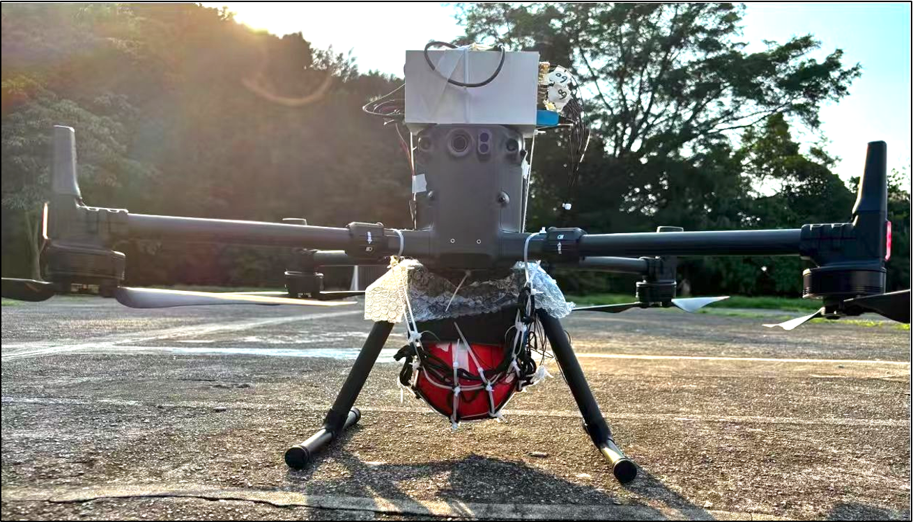
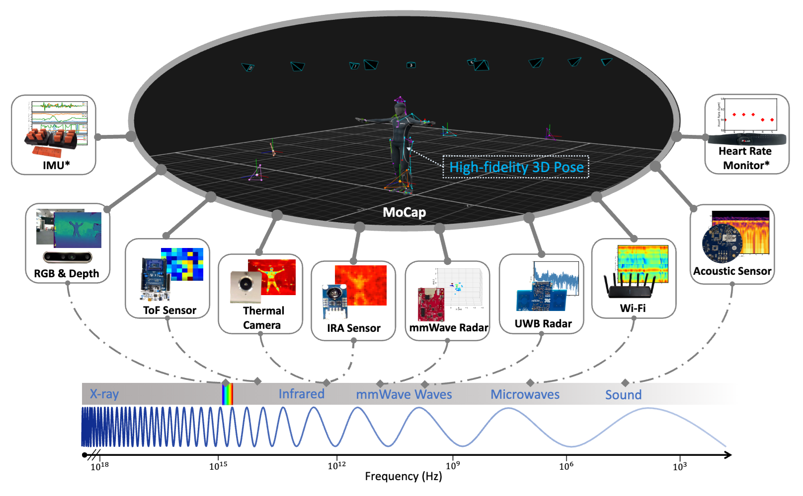
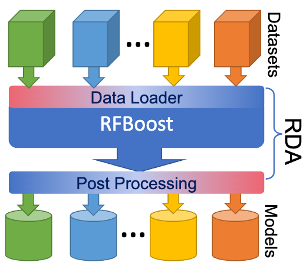
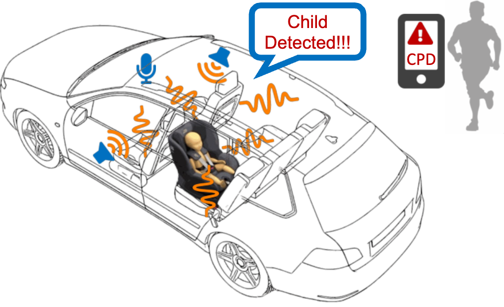

Hi, I'm a current Ph.D. candidate at [AIoT Lab](https://aiot.hku.hk){:target="_blank"}, The University of Hong Kong (HKU), supervised by [Prof. Chenshu Wu](https://cswu.me){:target="_blank"}. I began my Ph.D. journey in Fall 2021, after receiving my B.E. degree in Computer Science from Beijing University of Posts and Telecommunications (BUPT).

My research interests center on **Wireless Sensing** and **AIoT**, with a specific focus on making Wi-Fi sensing more ubiquitous and robust. I am currently working on boosting the sensing capabilities of Wi-Fi via deep learning, metamaterials, and multi-modal fusion to enable transformative applications in **smart IoT sensing**, **AI for Health**, and **Low-Altitude Economy** (e.g., drone-based sensing). My goal is to bridge the gap between theoretical wireless signals and practical, life-enhancing applications.

# Education

  

    
  

  

    <h3 class="edu-title">Ph.D. Candidate in Computer Science</h3>
    
The University of Hong Kong

    
Sept. 2021 - Present

    
Department of Computer Science, Supervised by Prof. Chenshu Wu

  

  

    
  

  

    <h3 class="edu-title">B.E. in Computer Science</h3>
    
Beijing University of Posts and Telecommunications (BUPT)

    
Sept. 2017 - June 2021

  

# Publications 
[[Google Scholar]](https://scholar.google.com/citations?user=4YsWXaoAAAAJ){:target="_blank"}

  

    
  

  

    Mobicom 2026
    <h3 class="pub-title">
      <a href="https://github.com/aiot-lab/Wi2SAR" target="_blank">"Take Me Home, Wi-Fi Drone": A Drone-based Wireless System for Wilderness Search and Rescue</a>
    </h3>
    
<strong>Weiying Hou</strong>, Luca Jiang-Tao Yu, Chenshu Wu

    

      <a href="https://github.com/aiot-lab/Wi2SAR" class="pub-link code" target="_blank"><i class="fab fa-github"></i> Code</a>
      <a href="https://aiot-lab.github.io/Wi2SAR/" class="pub-link website" target="_blank"><i class="fas fa-globe"></i> Website</a>
    

  

  

    
  

  

    NeurIPS 2025 (Datasets and Benchmarks Track)
    <h3 class="pub-title">
      <a href="https://neurips.cc/virtual/2025/loc/san-diego/poster/121376" target="_blank">OctoNet: A Large-Scale Multi-Modal Dataset for Human Activity Understanding Grounded in Motion-Captured 3D Pose Labels</a>
    </h3>
    
Dongsheng Yuan, Xie Zhang, <strong>Weiying Hou</strong>, Sheng Lyu, Luca Jiang-Tao Yu, Yuemin Yu, Chengxiao Li, Chenshu Wu

    

      <a href="https://openreview.net/pdf?id=z3TftXOizf" class="pub-link paper" target="_blank"><i class="fas fa-file-pdf"></i> Paper</a>
      <a href="https://github.com/aiot-lab/OctoNet" class="pub-link code" target="_blank"><i class="fab fa-github"></i> Code</a>
      <a href="https://aiot-lab.github.io/OctoNet/" class="pub-link website" target="_blank"><i class="fas fa-globe"></i> Website</a>
      <a href="https://neurips.cc/media/neurips-2025/Slides/121376.pdf" class="pub-link slides" target="_blank"><i class="fas fa-presentation"></i> Slides</a>
    

  

  

    
  

  

    Ubicomp/IMWUT 2024
    <h3 class="pub-title">
      <a href="https://dl.acm.org/doi/10.1145/3659620" target="_blank">RFBoost: Understanding and Boosting Deep WiFi Sensing via Physical Data Augmentation</a>
    </h3>
    
<strong>Weiying Hou</strong> and Chenshu Wu

    

      <a href="https://arxiv.org/pdf/2410.07230" class="pub-link paper" target="_blank"><i class="fas fa-file-pdf"></i> Paper</a>
      <a href="https://github.com/aiot-lab/RFBoost" class="pub-link code" target="_blank"><i class="fab fa-github"></i> Code</a>
    

  

  

    
  

  

    NSDI 2023
    <h3 class="pub-title">
      <a href="https://www.usenix.org/conference/nsdi23/presentation/zhang-yi" target="_blank">VeCare: Statistical Acoustic Sensing for Automotive InCabin Monitoring</a>
    </h3>
    
Yi Zhang, <strong>Weiying Hou</strong>, Yang Zheng, Chenshu Wu

    

      <a href="https://www.usenix.org/conference/nsdi23/presentation/zhang-yi" class="pub-link paper" target="_blank"><i class="fas fa-file-pdf"></i> Paper</a>
      <a href="https://youtu.be/jkd5PWkxdgE" class="pub-link video" target="_blank"><i class="fab fa-youtube"></i> Video</a>
    

  

# Awards & Honors
* *2026-01*, **Best Student Presentation** at the Second Low-Altitude Summit held in Hong Kong.
* *2024-10*, **UbiComp/IMWUT 2024 Student Travel Grant**.
* *2021-09*, **HKU Postgraduate Scholarship**.
* *2021-06*, **BUPT Outstanding Graduates**.

# Community Services
* **Reviewer**: TMC, IMWUT 2025.
* **Artifact Reviewer**: Mobicom 2023, OSDI/ATC 2023.

# Teaching Experience
* **Year 2021-2024. Operating System (COMP3230A). Professor: Prof. Chenshu Wu** 
I maintained and curated HKU COMP3230’s tutorial labs from 2021 to 2024 ([Repo](https://github.com/aiot-lab/HKU-COMP3230A-Tutorialabs){:target="_blank"}).
I built hands-on tutorials and mini-labs on C basics, signals, virtual memory, processes, Pthreads, and semaphores, turning theory into “it finally works!” moments.
 
 
*Now I’m proudly passing the torch to LLMs. May they grade fairly, debug patiently, and may their segmentation never fault. Thanks, Mr. Gs (**G**PT, **G**emini, **G**rok, and Claude)!*

